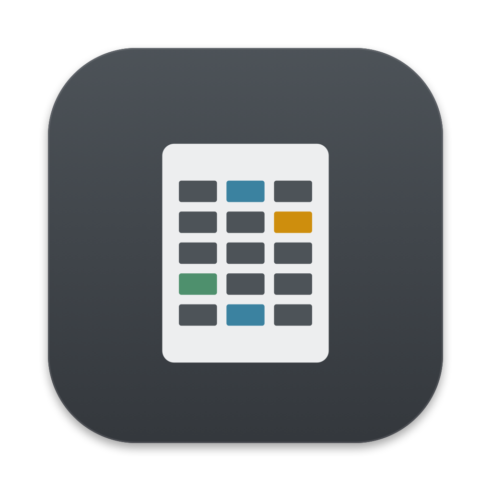

<h1 align="center">&nbsp;&nbsp;CINEMOSAIC</h1>

<p align="center"><code>Mac app</code>&nbsp;&nbsp;<code>macOS 11+</code>&nbsp;&nbsp;<code>free · GPL-3.0</code></p>

<p align="center">☕ If you use CineMosaic and like it, I would be glad if you <a href="https://buymeacoffee.com/moritzpoth">bought me a coffee</a>.</p>

Takes one still from the middle of every shot of a cut and lays them out on one sheet – a contact sheet of the whole film, to print or to send.

## What it does

- **Two sources.** A Media Composer bin with the Avid MediaFiles of your volumes – CineMosaic follows every shot of the sequence through effects, motion effects, multicam and nests to its media file, also into other bins of the project and to AMA-linked files. Or a master file of the cut with its cut list: EDL (CMX3600), Final Cut Pro 7 XML, FCPXML or AAF.
- **What you see.** At every moment the topmost video track with a clip counts; filler lets the tracks below show through. A clip partly covered from above becomes two shots. The still is the middle frame of each shot.
- **Picture format.** Black bars are cut off for 4:3, 1.66, 16:9, 1.85, 2.00, 2.35, 2.39 or any format of your own.
- **The sheet.** DIN A0–A6 or your own size, portrait or landscape, resolution in dpi, margin and gap in mm, columns automatic (largest stills) or fixed. A live preview shows the sheet as you set it up.
- **Saving.** PNG, TIFF and JPEG with the resolution in the file, PDF in the paper size.

CineMosaic only reads: it never changes media, bins or projects. English, German, French and Spanish, dark or light, a built-in manual (Help → CineMosaic Manual), updates from within the app.

Bins are read with a small reader of our own (`src/avb.rs`), AAF files with `src/aaf.rs`; both are based on the format knowledge of [pyavb](https://github.com/markreidvfx/pyavb) and [pyaaf2](https://github.com/markreidvfx/pyaaf2) (MIT, see THIRD-PARTY.md). Frames are read with [FFmpeg](https://ffmpeg.org).

## Install

Requires macOS 11 or later, Apple Silicon or Intel. Download `CineMosaic-<version>.zip` from [Releases](../../releases), unzip, move the app to Applications. It is not signed with a paid Apple certificate: on first launch open **System Settings → Privacy & Security** and click **Open Anyway** (once). When macOS asks whether CineMosaic may access files on removable or network volumes, allow it.

## Build

```
cargo test
scripts/build-mac-app.sh     # → dist/CineMosaic.app (universal) and a zip
cargo run --release --bin cinemosaic -- MASTER CUTLIST OUT.pdf [--paper A3 --landscape --dpi 300 --picture 2.39]
cargo run --release --bin cinemosaic -- --bin BIN.avb VOLUME[:VOLUME] OUT.png [--seq N]
```

Static `ffmpeg` and `ffprobe` for both architectures go into `vendor/ffmpeg/arm64/` and `vendor/ffmpeg/x86_64/`; the build script puts them into the app.

## License

Copyright © 2026 Moritz Poth. Free software under the GNU General Public License v3.0 or later – see [LICENSE](LICENSE). No warranty. Font: [JetBrains Mono](https://www.jetbrains.com/lp/mono/) (SIL Open Font License, `ui/fonts/OFL.txt`).

*Avid and Media Composer are trademarks of Avid Technology, Inc. This project is not affiliated with Avid.*
